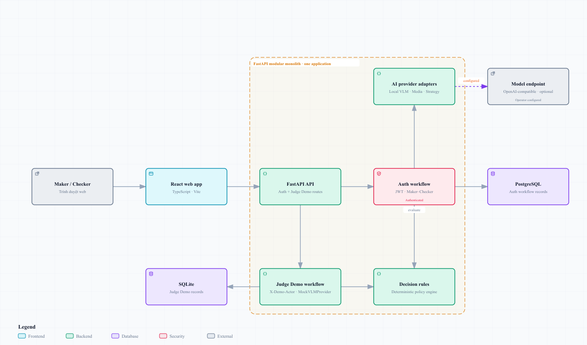

# OrganizationAI

Ứng dụng web hỗ trợ lập và phê duyệt kế hoạch marketing theo luồng Maker–Checker. Repository hiện có hai workflow chạy trên cùng FastAPI monolith:

- **Authenticated workflow**: tài khoản và vai trò dùng JWT cookie; kế hoạch, tệp đính kèm, phiên bản, đánh giá và audit lưu trong PostgreSQL.
- **Judge Demo**: dữ liệu tổng hợp, actor demo qua `X-Demo-Actor`, AI giả lập và SQLite riêng. Luồng này phục vụ demo/QA, không phải xác thực người dùng.

## Kiến trúc



[Mở sơ đồ HTML tương tác](docs/diagrams/organizationai-runtime-architecture.html) · [Xem tệp PNG](docs/diagrams/organizationai-runtime-architecture.png)

Sơ đồ được đối chiếu với mã nguồn và cấu hình của branch hiện tại. Model endpoint là thành phần tùy chọn, chỉ được dùng khi operator cấu hình.

## Chức năng hiện có

| Workflow | Khả năng |
| --- | --- |
| Authenticated | Đăng nhập/đăng ký, vai trò Maker/Checker/Admin, lưu draft, upload ảnh riêng tư, gửi duyệt, phiên bản và approval round, review/approve/reject, sửa và gửi lại, audit. Các màn hình quản trị nhân viên/tài khoản/vai trò cũng có trong code. |
| Judge Demo | Tạo và sửa draft, upload, gửi duyệt, xem queue/chi tiết/audit, Checker quyết định, Verify suites và tám seed scenario tổng hợp. Actor được chọn trong giao diện demo. |
| AI và quyết định | Local VLM adapter và Mock provider; đánh giá media/strategy riêng; budget/policy rules tất định. AI không tự từ chối. Thiếu cấu hình hoặc kết quả không hợp lệ sẽ chuyển hồ sơ sang Human Review. |

Auto-approval của Auth workflow tắt theo cấu hình mặc định. Demo HTTP cũng tắt auto-approval theo policy mặc định; seed `DEMO-SEED-AUTO` là scenario riêng để trình diễn nhánh đó.

## Sơ đồ dự án

```text
frontend/                   React, TypeScript, Vite, Vitest, Playwright
src/ai_pipeline/            Provider adapters, orchestrator, task evaluators
src/backend/api/            FastAPI: auth, authenticated workflow, Judge Demo
src/backend/application/    Workflow orchestration and AI configuration
src/backend/domain/         Workflow records, policies and business models
src/backend/db/             PostgreSQL/SQLAlchemy models and session setup
src/backend/repositories/   SQLite demo repository and its SQL migration
src/backend/rules/          Deterministic decision and budget rules
alembic/versions/           PostgreSQL schema migrations
deployment/                 Container/deployment helpers and validation
tests/                      Python unit/integration and synthetic fixtures
docs/                       Scope, contracts, integration notes and diagrams
compose.yaml                Local frontend + API + PostgreSQL
render.yaml                 Hosted static frontend + demo API blueprint
```

## Chạy Judge Demo trên máy cá nhân

Yêu cầu: Python 3.13 (Render cấu hình 3.13.14), Node.js 24.17.0/npm và hai terminal. Chế độ này chỉ cần API Python và frontend; dữ liệu demo được lưu vào SQLite.

### 1. Cài dependencies và khởi động API

```powershell
py -3.13 -m venv .venv
& .\.venv\Scripts\Activate.ps1
python -m pip install -r requirements.txt

$env:APP_ENV = 'demo'
$env:DEMO_DATABASE = 'runtime/demo-organization.sqlite3'
$env:DEMO_MOCK_MODE = 'pass'
$env:CORS_ORIGINS = 'http://localhost:5173,http://127.0.0.1:5173'

python -m src.backend.seed_demo
python -m uvicorn src.backend.api.app:app --host 127.0.0.1 --port 8010
```

Seed tạo các scenario `AUTO`, `BUDGET`, `REVIEW`, `TIMEOUT`, `FACTS`, `DRAFT`, `APPROVED` và `REJECTED`. Có thể đặt `DEMO_MOCK_MODE` thành `pass`, `review`, `timeout`, `error` hoặc `malformed` để thử các kết quả provider được hỗ trợ.

### 2. Khởi động frontend

Mở terminal thứ hai tại thư mục gốc:

```powershell
npm ci --prefix frontend
$env:VITE_API_BASE_URL = 'http://localhost:8010/api'
$env:VITE_DEMO_ENABLED = 'true'
npm run dev --prefix frontend -- --host 127.0.0.1
```

Mở địa chỉ Vite được in ra trong terminal. API health check là `http://127.0.0.1:8010/api/health`; tài liệu API là `http://127.0.0.1:8010/docs`.

## Chạy Auth workflow bằng Docker Compose

Compose khởi động PostgreSQL 16, FastAPI và Vite. Backend tự chạy Alembic migrations và seed tài khoản development khi khởi động. Trước khi chạy, tạo `.env` từ mẫu và thay các giá trị placeholder; `DATABASE_URL` phải dùng cùng mật khẩu với `POSTGRES_PASSWORD`, còn `JWT_SECRET` phải có ít nhất 32 byte ngẫu nhiên.

```powershell
Copy-Item .env.example .env
# Chỉnh POSTGRES_PASSWORD, DATABASE_URL, JWT_SECRET và AUTH_SEED_PASSWORD trong .env
docker compose up --build
```

- Frontend: `http://localhost:5173`
- API và OpenAPI: `http://localhost:8010/docs`
- PostgreSQL: chỉ bind trên loopback, cổng host `5433`
- Tài khoản seed local: `maker`, `checker`, `admin`; mật khẩu ban đầu lấy từ `AUTH_SEED_PASSWORD`.

Các tài khoản mẫu và mật khẩu trong `.env` chỉ dùng ở môi trường local. Không đưa bí mật thật vào Git. Nếu chạy API trực tiếp thay vì Compose, Alembic cần `DATABASE_URL`; file `.env` không được tự động nạp khi chạy Uvicorn từ shell.

## Cấu hình AI

`.env.example` là danh sách cấu hình hiện hành. Các giá trị endpoint, model, API key, media policy và strategy rubric để trống theo mặc định. Không có endpoint/model bên ngoài nào được gọi cho đến khi operator cấu hình rõ.

- **Judge Demo** luôn dùng `MockVLMProvider`; `DEMO_MOCK_MODE` chọn scenario giả lập.
- **Authenticated workflow** chọn `LOCAL_VLM` mặc định. Cần cấu hình `LOCAL_VLM_MODEL`, `LOCAL_VLM_MODEL_VERSION` và `LOCAL_VLM_BASE_URL` cho runtime tương thích Chat Completions (`/v1`). Lỗi không tự chuyển sang Mock.
- Media Compliance và Strategy Evaluation là các task provider độc lập, cấu hình bằng nhóm `AUTH_WORKFLOW_MEDIA_*` và `AUTH_WORKFLOW_STRATEGY_*`. Chỉ điền policy/rubric đã được phê duyệt vào `AUTH_WORKFLOW_MEDIA_POLICY_JSON` và `AUTH_WORKFLOW_STRATEGY_RUBRIC_JSON`.
- Endpoint ngoài máy local bị chặn mặc định. Chỉ bật `*_ALLOW_REMOTE=true` khi đã được cho phép; endpoint từ xa phải dùng HTTPS. Giữ API key trong `.env` local hoặc secret store.
- Budget được kiểm tra bằng rules engine. Auto-approval Auth vẫn tắt khi policy/budget/authority chưa được cấu hình; provider lỗi, timeout, thiếu evidence hoặc output không hợp lệ sẽ yêu cầu Checker review.

Khi backend chạy trong Compose và model chạy trên host, dùng `http://host.docker.internal:<port>/v1`, không dùng `localhost` từ bên trong container. Xem [hướng dẫn cấu hình inference local](docs/integration/local-media-strategy-inference.md) để biết thêm giới hạn giao thức và kiểm chứng runtime.

## API

- `/api/auth/*`: đăng nhập, đăng ký, kích hoạt, session và logout; phiên đăng nhập dùng JWT cookie HttpOnly.
- `/api/workflow/*`: authenticated plans, attachments riêng tư, review queue, decisions, audit và các route quản trị. Quyền được kiểm tra phía backend.
- `/api/plans`, `/api/reviews`, `/api/verify`: Judge Demo, chỉ khả dụng khi `APP_ENV=demo`; mutation dùng `X-Demo-Actor` và `Idempotency-Key`.
- `/api/health`: liveness. `/api/health/ready`: kiểm tra kết nối Auth PostgreSQL.

Chi tiết request/response và ví dụ nằm trong [API examples](docs/integration/api-examples.md). Khi API chạy, FastAPI cung cấp OpenAPI UI tại `/docs`.

## Kiểm tra và build

```powershell
# Backend: unit và integration tests
python -m pytest

# Frontend
npm ci --prefix frontend
npm run test --prefix frontend
npm run typecheck --prefix frontend
npm run build --prefix frontend

# Browser end-to-end (cần cài browser cho Playwright)
npm run test:e2e --prefix frontend
```

Frontend chưa khai báo script lint trong `frontend/package.json`. Bộ kiểm thử Python nằm dưới `tests/`; frontend dùng Vitest/Testing Library và Playwright.

## Deployment

`render.yaml` mô tả một static frontend và một Python API service cho Judge Demo. Trước khi tạo/deploy service, cần cung cấp `VITE_API_BASE_URL` cho frontend và một `CORS_ORIGINS` HTTPS chính xác cho backend trong Render dashboard. Blueprint đặt `autoDeployTrigger: off`.

Render blueprint chỉ cấu hình demo SQLite tại `/tmp/organizationai/demo-organization.sqlite3`; đây là lưu trữ tạm thời và không đảm bảo giữ dữ liệu sau khi instance khởi động lại. Blueprint không khai báo PostgreSQL hay cấu hình Auth workflow. Dùng Compose/PostgreSQL hoặc cấu hình hạ tầng bền vững riêng trước khi dùng dữ liệu Auth.

## Giới hạn đã biết

- Actor của Judge Demo là actor tổng hợp, không thay thế đăng nhập hoặc kiểm soát danh tính thật.
- Auth workflow cần PostgreSQL và cấu hình môi trường riêng. Mẫu hiện tại không cung cấp budget, authority, media policy, strategy rubric hay auto-approval policy đã được tổ chức phê duyệt.
- Model/runtime không được đóng gói cùng repository. Tên provider hoặc protocol tương thích không xác nhận rằng một runtime cụ thể đã được kiểm chứng.
- Render blueprint dùng một API instance và SQLite ephemeral; không phải cấu hình lưu trữ production.

## Tài liệu

- [Phạm vi Phase 1](docs/scope-phase-1.md)
- [Deliverables Sprint 1](docs/sprint-1-deliverables.md)
- [Marketing approval policy](docs/role1/v2.1/02-marketing-approval-policy.md)
- [API examples](docs/integration/api-examples.md)
- [Authenticated workflow và PostgreSQL](docs/integration/authenticated-workflow-postgresql.md)
- [Cấu hình Local VLM và task evaluators](docs/integration/local-media-strategy-inference.md)
- [Decision contract](docs/contracts/decision-contract.md)
- [Evaluation schema](docs/contracts/evaluation-schema.md)
- [Audit event schema](docs/contracts/audit-event-schema.md)

## License

Repository hiện chưa khai báo giấy phép.
