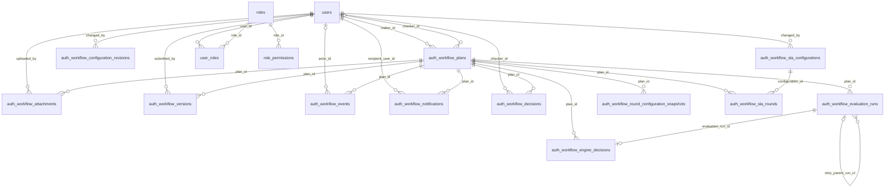

# Core Auth workflow data model (ERD)

**Purpose:** Show the PostgreSQL entities and foreign-key relationships used by the authenticated plan workflow. There is no separate approval-round table: the submitted round number is stored on auth_workflow_versions, auth_workflow_decisions, and related run/snapshot rows.

**Code basis:** [auth_workflow.py](../../src/backend/db/models/auth_workflow.py), [approval_configuration.py](../../src/backend/db/models/approval_configuration.py), [sla.py](../../src/backend/db/models/sla.py), [user.py](../../src/backend/db/models/user.py), [role.py](../../src/backend/db/models/role.py), and Alembic migrations under [alembic/versions](../../alembic/versions/).

Source commit: b67a658f357c482bd817d4230376c68d31c7ba35 (origin/main).

## Relationship notes

- auth_workflow_versions stores both version_number and round_number; each plan has a unique version and a unique round in that table. No approval_rounds table exists.
- auth_workflow_decisions has a unique (plan_id, round_number); auth_workflow_engine_decisions references the evaluation run and plan, and limits outcomes to AUTO_APPROVED or HUMAN_REVIEW_REQUIRED.
- auth_workflow_round_configuration_snapshots points to the plan and contains configuration and Checker assignment snapshots as JSON. It does not have foreign keys to individual config revisions.
- Evaluation results are JSON columns on auth_workflow_evaluation_runs; Media, Strategy, and VLM extraction are not separate result tables.
- This is the Auth/PostgreSQL model only. Judge Demo's SQLite repository is a separate profile.
